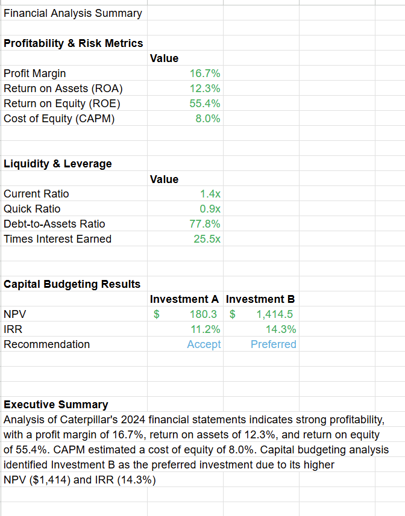

# Caterpillar Financial Statement Analysis

## Overview

This project analyzes Caterpillar Inc.'s financial performance using publicly available SEC Form 10-K data. The analysis includes income statement, balance sheet, and cash flow statement evaluation, along with financial ratio analysis, cost of equity estimation using the Capital Asset Pricing Model (CAPM), and capital budgeting techniques using Net Present Value (NPV) and Internal Rate of Return (IRR). 【1-d0c085】

## Project Objectives

- Evaluate Caterpillar's financial performance and position.
- Assess profitability, liquidity, leverage, and asset utilization.
- Estimate cost of equity using CAPM.
- Apply capital budgeting techniques to evaluate investment opportunities.
- Present financial findings through a structured Excel analysis workbook. 【1-d0c085】

## Skills Demonstrated

- Financial Statement Analysis
- Financial Modeling in Microsoft Excel
- Ratio Analysis
- Capital Asset Pricing Model (CAPM)
- Net Present Value (NPV)
- Internal Rate of Return (IRR)
- Capital Budgeting
- Business and Financial Reporting
- SEC 10-K Analysis 【1-d0c085】

## Key Findings

### Profitability

| Metric | Result |
|----------|----------:|
| Profit Margin | 16.7% |
| Return on Assets (ROA) | 12.3% |
| Return on Equity (ROE) | 55.4% |

### Liquidity & Leverage

| Metric | Result |
|----------|----------:|
| Current Ratio | 1.42 |
| Quick Ratio | 0.89 |
| Debt-to-Assets Ratio | 77.8% |
| Times Interest Earned | 25.5x |

### Cost of Equity

- CAPM Estimated Cost of Equity: **8.0%**

### Capital Budgeting

- Both investment alternatives generated positive NPVs.
- Investment B was selected as the preferred alternative due to its higher NPV and IRR.
- NPV and IRR were used to evaluate expected returns against the required rate of return. 【1-d0c085】

## Financial Analysis Summary

## Workbook Structure

### Financial Analysis Summary
Executive dashboard presenting key findings and conclusions.

### Income Statement
Analysis of revenue, operating profit, and net income trends.

### Balance Sheet
Evaluation of assets, liabilities, and shareholders' equity.

### Statement of Cash Flows
Review of operating, investing, and financing cash flows.

### Appendix - Ratio Calculations
Supporting calculations for profitability, liquidity, leverage, and asset utilization metrics.

### Appendix - CAPM Calculations
Cost of equity estimation using the Capital Asset Pricing Model.

### Appendix - NPV & IRR Calculations
Supporting capital budgeting calculations and investment evaluation.

## Tools Used

- Microsoft Excel
- SEC Form 10-K Financial Statements
- Financial Ratio Analysis
- CAPM
- NPV Analysis
- IRR Analysis
- Corporate Finance Principles

## Disclaimer

This project was developed for educational and portfolio purposes using publicly available financial information. Calculations and conclusions are intended to demonstrate financial analysis and modeling techniques.
